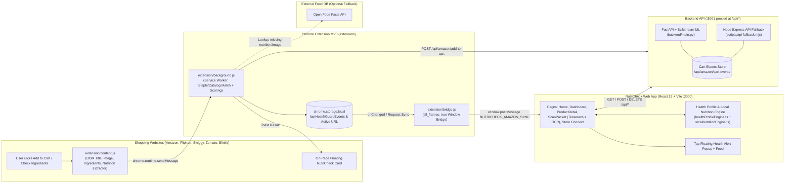

# NutriCheck – Personalized Food & Store Ingredient Analyzer

**NutriCheck** is a full-stack personalized packaged-food screening platform paired with a **Chrome Manifest V3 Extension**. It lets users set up a personal health profile (age, health conditions such as Diabetes, Hypertension, Heart Disease, Kidney Disease, Obesity, and food allergies) and evaluates packaged food labels, camera/uploaded packet photos (via client-side OCR), and live e-commerce **Add to Cart** events from **Amazon, Flipkart, Swiggy Instamart, Zomato, and Blinkit**.

---

## Key Features

- **Personalized Health Profile & Risk Screening**
  - Register or sign in with age, health conditions (`diabetes`, `hypertension`, `heart_disease`, `kidney_disease`, `obesity`), and allergens.
  - Dynamically classifies every product as **LOW RISK**, **MODERATE RISK**, or **HIGH RISK** with plain-language explanations and safer swap suggestions.
- **Visual Product Catalogue & Detail Analyzer**
  - Browse packaged food items with product photography, sugar/sodium/saturated fat badges, interactive nutrient & ingredient breakdown pie charts, and allergen warnings.
  - Add custom products with nutrition panels, ingredients, product images, and store links.
- **Scan Packet (OCR + Label Parser)**
  - Upload a photo or use the device camera (`tesseract.js`) or paste raw ingredient/nutrition label text to classify ingredients (**Good**, **Caution**, **Watch/Bad**) and compute an overall health score (`0–100`).
- **Store Connect + Live Chrome Extension (`extension/`)**
  - Automatically detects **Add to Cart** clicks across **Amazon, Flipkart, Swiggy Instamart, Zomato, and Blinkit**.
  - Extracts the product title, product photo, ingredients, nutrition facts, and brand/barcode from the storefront DOM.
  - Displays an instant floating health alert card directly on the shopping website AND syncs the item (with image, ingredients, macros, and personalized risk alert) to the **Store Connect** (`/amazon`) feed and top notification popup inside NutriCheck.

---

## System Design & Data Flow Diagram

### High-Level Architecture (Mermaid)



### How Frontend, Backend, and Extension Work Together

```
1. User Setup (Frontend):
   User signs up (/register) -> AuthContext saves health profile (age, conditions, allergies)
   -> healthProfileEngine.ts screens Dashboard catalogue & Store Connect items in real time.

2. Packet Scan Flow (/scan):
   User uploads/captures packet photo -> Tesseract.js extracts label text in browser
   -> POST /api/scan-packet (or localNutritionEngine.ts fallback if offline)
   -> Returns Good / Caution / Watch ingredients + Macro Score (0-100).

3. Store Connect & Extension Flow (/amazon):
   [On Amazon / Flipkart / Swiggy / Zomato / Blinkit]
   User clicks "Add to Cart"
     ├──► extension/content.js captures product title, image URL, ingredients & nutrition DOM
     ├──► Sends payload to extension/background.js
     ├──► background.js calls POST <app-url>/api/amazon/add-to-cart
     │       ├── If Backend (FastAPI or Node Express :8001) responds -> returns analyzed event
     │       └── If offline/proxied -> background.js runs local catalog/staple + Open Food Facts scorer
     ├──► background.js saves event in chrome.storage.local AND returns instant card to shopping page
     └──► extension/bridge.js (injected in all frames) relays NUTRICHECK_AMAZON_SYNC to App.tsx
          -> NutriCheck pops up the product image + ingredients + health alert at top & adds to /amazon!
```

---

## Tech Stack

| Layer | Technologies |
| :--- | :--- |
| **Frontend** | React 19, TypeScript, Vite 8, React Router v7, Tailwind CSS v4, Lucide Icons, Tesseract.js (OCR) |
| **Backend (Primary)** | Python 3, FastAPI, Uvicorn, Pandas, Scikit-learn, Joblib (`backend/main.py`) |
| **Backend (Node Fallback)** | Express 4 on port `8001` (`scripts/api-fallback.mjs`), automatically launched by `npm run dev` when Python/Uvicorn is not installed |
| **Extension** | Chrome Manifest V3 (`extension/`): `content.js`, `background.js`, `bridge.js`, `popup.html`, `popup.js`, bundled `food_catalog.json` |

---

## Project Structure

```text
.
├── backend/
│   └── main.py                  # FastAPI + Scikit-learn ML nutrition & Amazon intake API
├── ml/
│   ├── train_pipeline.py        # ML model training & evaluation pipeline
│   └── inspect_eda.py           # Exploratory dataset inspection script
├── extension/
│   ├── manifest.json            # Chrome Extension MV3 manifest (stores + all_frames bridge)
│   ├── content.js               # Add-to-Cart capture & floating nutrition popup on store pages
│   ├── background.js            # Extension service worker (API sync + offline catalog/OFF fallback)
│   ├── bridge.js                # Two-way window.postMessage <-> chrome.storage bridge
│   ├── popup.html / popup.js    # Extension settings popup (auto-detects active app URL)
│   └── food_catalog.json        # Bundled packaged-food lookup table
├── scripts/
│   ├── start-dev.mjs            # Unified launcher: starts FastAPI OR Node API (:8001) + Vite (:3000)
│   └── api-fallback.mjs         # Express fallback API server (:8001) with CORS & scoring engine
├── src/
│   ├── assets/images/           # Bundled studio product images for the catalogue
│   ├── components/              # TopBar, Footer, AmazonConnectView, BreakdownPieChart, etc.
│   ├── context/                 # AuthContext (profile, conditions, allergies, custom products)
│   ├── pages/                   # Home, Login, Register, Dashboard, ProductDetail, AddProduct, Profile, ScanPacket
│   ├── utils/                   # healthProfileEngine.ts, localNutritionEngine.ts, catalogImages.ts
│   ├── App.tsx                  # Routing, extension bridge sync & top Add-to-Cart alert popup
│   └── index.css                # Global emerald/mint design tokens & responsive styles
├── package.json
├── requirements.txt
└── vite.config.ts               # Proxies /api/* requests to http://127.0.0.1:8001
```

---

## Getting Started (Local Development)

### 1. Clone the Repository

```bash
git clone <your-repository-url>
cd <repository-folder>
```

### 2. Install Frontend & Node Dependencies

Requires **Node.js 18+** (or 20+).

```bash
npm install
```

### 3. (Optional) Set Up Python ML Backend

The dev launcher automatically starts the **Node Express API fallback** on port `8001` if Python/Uvicorn is not detected, so the app works immediately out of the box with just `npm run dev`.  
If you want to run the **FastAPI + Scikit-learn ML** backend (`backend/main.py`) instead:

```bash
python -m venv .venv
# Linux/macOS:
source .venv/bin/activate
# Windows:
# .venv\Scripts\activate

pip install -r requirements.txt
```

### 4. Start the Application

```bash
npm run dev
```

This single command:
1. Starts the API server on `http://127.0.0.1:8001` (FastAPI if `.venv`/Uvicorn is available, otherwise Node Express fallback).
2. Starts the Vite frontend dev server on **`http://localhost:3000`** with `/api` proxied to `:8001`.

Open **`http://localhost:3000`** in Chrome/Edge.

### 5. Build for Production

```bash
npm run lint     # TypeScript type-check (tsc --noEmit)
npm run build    # Production Vite bundle -> dist/
npm run preview  # Preview production build
```

---

## Chrome Extension Setup (`extension/`)

1. Open **`chrome://extensions`** (or `edge://extensions`).
2. Enable **Developer mode** (top-right toggle).
3. Click **Load unpacked** and select the **`extension/`** directory from this repo.
4. Open the NutriCheck web app (e.g., `http://localhost:3000`), sign in, and visit **Store Connect** (`/amazon`). The extension automatically detects your active NutriCheck URL (or click the NutriCheck puzzle icon in Chrome to verify/save the URL).
5. Visit **Amazon, Flipkart, Swiggy Instamart, Zomato, or Blinkit**, click **Add to Cart** on any food item, and:
   - An instant **NutriCheck** overlay pops up on the store page with the product image, ingredients, macro breakdown, and score.
   - The item automatically syncs to **Store Connect** (`/amazon`) with a top notification banner inside NutriCheck.

> **Tip:** Whenever you pull updates to `extension/`, click the **Reload (`↻`)** button on the extension card in `chrome://extensions` and refresh your open tabs.

---

## REST API Reference

All routes are served on port `8001` and proxied via Vite at `/api/*`:

| Method | Endpoint | Description |
| :--- | :--- | :--- |
| `GET` | `/api/health` | Health check returning active engine status |
| `GET` | `/api/amazon/cart-events` | Retrieve synced Add-to-Cart events (newest first) |
| `POST` | `/api/amazon/add-to-cart` | Analyze & store a store Add-to-Cart payload (`product_title`, `ingredients_text`, `nutrition_text`, `image_url`, `product_url`, `source_platform`) |
| `DELETE` | `/api/amazon/cart-events` | Clear all synced cart events |
| `DELETE` | `/api/amazon/cart-events/:id` | Delete a specific cart event by `event_id` |
| `POST` | `/api/scan-packet` | Parse and classify packet ingredients and nutrition text |

---

## Health Screening Disclaimer

NutriCheck provides **educational nutrition and ingredient screening estimates** based on product label data and user-provided profile preferences. It is not a medical diagnostic tool—always inspect the physical package label for allergens and consult a qualified healthcare professional for clinical dietary guidance.
